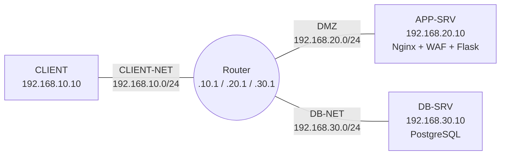

# Laboratorium P02 w GNS3: opis, dowody i instrukcja odtworzenia

Dokument opisuje gotowe laboratorium projektu P02 (bezpieczna aplikacja WWW w trzech segmentach sieci), to, co nim udowodniliśmy, oraz jak każdy z zespołu odtworzy je u siebie. Pliki laboratorium są w katalogu `lab/`, a konfiguracje zabezpieczeń w `waf/`, `database/` i `app/`.

## 1. W skrócie

- Lab to projekt GNS3 z **czterema węzłami Docker**: Router, CLIENT, APP-SRV, DB-SRV. Działa **bez KVM i bez maszyn VirtualBox** (węzły to kontenery w maszynie GNS3 VM).
- Wszystkie wymagania z tematu nr 2 (TLS 1.3, blokada SSH, WAF z trzema regułami, utwardzenie DB-SRV, rozdzielenie warstw na różne hosty) są wdrożone i sprawdzone testami `tests/poc-tests.sh`.
- Wynik: 11 testów z Issue #21 przeszło **przed i po restarcie** wszystkich węzłów (klient `PASS=9`, APP-SRV `PASS=11`). Szczegóły: `docs/poc-results.md`, logi `docs/logs/poc/gns3-*.log`, zrzuty `docs/screenshots/poc/gns3-*.png`.
- Odtworzenie: zbudować 4 obrazy (`bash lab/build.sh`), uruchomić `python lab/gns3/create-project.py` i odpalić testy. Szczegóły w sekcji 6.

## 2. Topologia i adresacja



| Węzeł | Obraz | Interfejsy | Rola |
|---|---|---|---|
| Router | `p02/router` | eth0 = 192.168.10.1, eth1 = 192.168.20.1, eth2 = 192.168.30.1 | jedyna droga między segmentami, filtruje ruch (`nftables`, forward = drop) |
| CLIENT | `p02/client` | eth0 = 192.168.10.10, brama .10.1 | użytkownik testowy (curl, openssl, testy) |
| APP-SRV | `p02/app-srv` | eth0 = 192.168.20.10, brama .20.1 | Nginx (TLS 1.3) + ModSecurity/OWASP CRS + aplikacja Flask |
| DB-SRV | `p02/db-srv` | eth0 = 192.168.30.10, brama .30.1 | PostgreSQL utwardzony |

Segmenty są rozdzielone: CLIENT nie ma bezpośredniej trasy do DB-SRV, a każdy pakiet między segmentami przechodzi przez router i jego reguły. Warstwa aplikacji (APP-SRV) i warstwa danych (DB-SRV) są na osobnych hostach, jak wymaga temat.

## 3. Jak działa każdy element

### 3.1 Router (`lab/router/nftables.conf`)

Polityka `forward` to `drop`, a przepuszczane jest tylko to, co wynika z `network/traffic-matrix.md`:

| Źródło → cel | Port | Decyzja |
|---|---|---|
| CLIENT → APP-SRV | TCP/443 | zezwól |
| CLIENT → APP-SRV | TCP/22, TCP/80 | zablokuj (licznik + log) |
| CLIENT → DB-SRV | wszystko | zablokuj (licznik + log) |
| APP-SRV → DB-SRV | TCP/5432 | zezwól |
| pozostałe | - | zablokuj; wyjątek: ruch powiązany z już nawiązanym oraz ICMP do diagnostyki |

Każda reguła ma licznik (`counter`), więc `nft list ruleset` na routerze jest dowodem, że ruch faktycznie był przepuszczany lub odrzucany. Wpisy `log` trafiają do dziennika jądra hosta, który nie jest widoczny w kontenerze, dlatego jako dowód używamy liczników.

### 3.2 APP-SRV (`waf/`, `app/`)

- **TLS 1.3:** Nginx słucha na `443` z `ssl_protocols TLSv1.3` (`waf/nginx/secure-app.conf`). Certyfikat RSA 4096 z SAN (`secure-app.lab`, `192.168.20.10`) generuje się przy pierwszym starcie kontenera (jest samopodpisany, więc `curl` używa `-k`).
- **Blokada SSH:** na APP-SRV nie działa żaden serwer SSH, a `nftables` (`waf/nftables.conf`) dodatkowo odrzuca `tcp dport 22`. Router blokuje 22 także na ścieżce z klienta.
- **WAF (host-based, ModSecurity v3 + OWASP CRS):** reguły własne w `waf/modsecurity/custom-rules.conf`:
  - `100001` blokuje SQL Injection w `POST` (HTTP 403, np. `'OR 2>1--`),
  - `100002` blokuje Path Traversal w `GET` (HTTP 403, np. `../../../../../etc/passwd`),
  - `100003` tylko **loguje** Command Injection w `GET` (np. `ls -la`), bez blokowania.
  Log audytowy: `/var/log/modsec_audit.log` (na APP-SRV).
- **Aplikacja (Flask, gunicorn):** nasłuchuje tylko na `127.0.0.1:5000` za Nginx. `POST /message` zapisuje rekord w bazie zapytaniem parametryzowanym. Endpoint `/command` celowo nie wykonuje poleceń (służy do testów WAF).

### 3.3 DB-SRV (`database/`)

Utwardzenie dotyczy tylko serwera bazy, zgodnie z tematem:
- PostgreSQL nasłuchuje wyłącznie na `127.0.0.1` i `192.168.30.10`,
- `pg_hba.conf` dopuszcza tylko `webapp_user` z `192.168.20.10/32` do bazy `webapp_db`, hasła w formie SCRAM-SHA-256,
- firewall hostowy `nftables` z polityką `drop` i dostępem do 5432 tylko z APP-SRV,
- logowanie połączeń i rozłączeń,
- konto aplikacji ma tylko `SELECT` i `INSERT` na tabeli `messages` (`database/init.sql`).

### 3.4 Jak to działa w GNS3 (nietypowa część)

- GNS3 uruchamia kontenery w maszynie **GNS3 VM** (Docker), więc nie jest potrzebna wirtualizacja sprzętowa ani węzły Qemu.
- Interfejsy `eth0..ethN` kontenerowi dodaje GNS3 już po jego starcie. Skrypt startowy każdego obrazu (`lab/*/entrypoint.sh` z funkcjami z `lab/common/lib.sh`) czeka na interfejs, ustawia adres IP i trasę domyślną, ładuje `nftables`, uruchamia usługi, a na końcu otwiera powłokę (to jest konsola węzła w GNS3).
- Adresy IP i reguły są więc zapisane w obrazach, a nie w topologii. Topologię (4 węzły i 3 łącza) tworzy `lab/gns3/create-project.py` przez API GNS3.

## 4. Co udowodniliśmy

| Wymaganie z tematu | Test | Dowód |
|---|---|---|
| Komunikacja z APP-SRV po TLS 1.3 | 1, 2 | `GET /` zwraca 200, a `openssl` negocjuje `TLS_AES_256_GCM_SHA384` w TLS 1.3 |
| Słabszy protokół odrzucony | 3 | handshake TLS 1.2 odrzucony |
| Blokada SSH do APP-SRV | 4 | port 22 niedostępny z klienta, router odrzuca 22/80 (licznik), na APP-SRV brak serwera SSH i aktywna reguła `dport 22 drop` |
| WAF blokuje SQL Injection w POST | 6 | HTTP 403 |
| WAF blokuje Path Traversal w GET | 7 | HTTP 403 |
| WAF loguje Command Injection w GET | 8 | wpis reguły 100003 w `modsec_audit.log` ze znacznikiem z testu, a polecenie nie jest wykonane |
| Rozdzielenie warstw / segmentacja | 9, 10 | klient nie łączy się z DB (router odrzuca), APP-SRV łączy się z DB przez router i zapisuje rekordy |
| Poprawne działanie usługi | 5 | `POST` zwraca 201 i zapis w bazie |
| Trwałość konfiguracji | 11 | po zatrzymaniu i uruchomieniu wszystkich węzłów testy przechodzą ponownie, dane w bazie zostają |

## 5. Ograniczenia i różnice względem maszyn wirtualnych

Warto je ująć w raporcie:
- Flask działa w tym samym kontenerze co Nginx (bez Dockera w Dockerze), a testy „usług” sprawdzają procesy zamiast jednostek systemd.
- Połączenie APP-SRV → DB-SRV w tym labie **nie jest szyfrowane** (w `postgresql.conf.fragment` nie ma ustawień SSL). Ruch jest ograniczony do DB-NET i reguł routera, ale decyzję, czy dodać szyfrowanie tej ścieżki, musi podjąć zespół.
- Certyfikat TLS jest samopodpisany, a hasło konta bazy (`P02-lab-Passw0rd`) jest tylko laboratoryjne (zmienna `DB_PASSWORD`).
- Po restarcie identyfikatory rekordów w bazie przeskakują (np. z 2 na 35). To normalne zachowanie sekwencji PostgreSQL po restarcie bez czystego zamknięcia, dane nie giną.
- Logi `log` routera nie są widoczne w kontenerze, dlatego dowodem filtrowania są liczniki `nft`.

## 6. Jak odtworzyć lab u siebie

### Wymagania
- GNS3 2.2.x z GNS3 VM (VirtualBox), Python 3 na komputerze z GNS3, internet na czas budowy obrazów.
- GNS3 VM musi mieć kartę 1 **host-only** i kartę 2 **NAT** (bez karty NAT GNS3 odmawia uruchomienia VM z błędem „must have a NAT or NAT Network interface”).

### Krok 1: obrazy w GNS3 VM
1. Jeśli NAT w VirtualBoxie nie daje internetu (zdarza się, test: `ping 8.8.8.8` w konsoli GNS3 VM), na czas budowy ustaw kartę 2 jako **mostkowaną**, uruchom GNS3 VM z VirtualBoxa i połącz się z internetem (`sudo dhclient eth1`, potem `ping deb.debian.org`).
2. W konsoli GNS3 VM (**Shell**):
```bash
git clone https://github.com/Montjoje/network-security-p02.git
cd network-security-p02
bash lab/build.sh
sudo docker images | grep p02/     # cztery obrazy
```
3. Wyłącz GNS3 VM i **przywróć kartę 2 na NAT**. Dalej VM uruchamia GNS3 (Edit → Preferences → GNS3 VM → Enable the GNS3 VM). Obrazy zostają na dysku maszyny.

### Krok 2: projekt w GNS3
Na komputerze z GNS3 pobierz skrypt (lub użyj sklonowanego repozytorium) i uruchom go. Port i dane logowania lokalnego serwera są w pliku `gns3_server.ini` (Windows: `%APPDATA%\GNS3\2.2\`; pola `port`, `user`, `password`):
```powershell
Invoke-WebRequest "https://raw.githubusercontent.com/Montjoje/network-security-p02/main/lab/gns3/create-project.py" -OutFile create-project.py
$pw = ((Select-String -Path "$env:APPDATA\GNS3\2.2\gns3_server.ini" -Pattern '^\s*password\s*=\s*(.*)$').Matches[0].Groups[1].Value).Trim()
python create-project.py --server http://127.0.0.1:PORT --user admin --password $pw --start
```
Jeśli serwer nie wymaga logowania, pomiń `--user` i `--password`. Potem **File → Open project → `p02-lab-docker`**. (Na Linuksie i macOS plik konfiguracji leży w innym miejscu, a ta ścieżka nie była u nas testowana.)

### Krok 3: testy
Poczekaj około 1–2 minuty po starcie (certyfikat RSA, start PostgreSQL). Konsole węzłów: prawy przycisk → **Console**.

CLIENT:
```bash
bash /opt/p02/tests/poc-tests.sh client 2>&1 | tee /root/poc-client.log
```
APP-SRV (znacznik `MARKER=...` z wyniku klienta):
```bash
bash /opt/p02/tests/poc-tests.sh app 192.168.20.10 192.168.30.10 MARKER 2>&1 | tee /root/poc-app.log
```
Router (dowód filtrowania):
```bash
nft list ruleset | grep -E "drop|accept"
```
Oczekiwane: klient `PASS=9 FAIL=0`, APP-SRV `PASS=11 FAIL=0`, liczniki reguł routera większe od 0.

Test 11 (po restarcie): w GNS3 zatrzymaj i uruchom wszystkie węzły, odczekaj minutę i powtórz kroki testowe z nowym znacznikiem.

### Problemy, które już się zdarzyły
| Objaw | Przyczyna i rozwiązanie |
|---|---|
| `must have a NAT or NAT Network interface` | GNS3 VM nie ma karty NAT, dodaj ją (VirtualBox → Ustawienia → Network → Expert → Karta 2) |
| GNS3 VM nie ma internetu przez NAT | użyj karty mostkowanej na czas budowy obrazów (krok 1) |
| `docker build`: `"/lab/..." not found` | stara wersja repozytorium, zrób `git pull` (katalog `lab/common` zastąpił ignorowany przez Git `lab/lib`) |
| skrypt: `BLAD 401` | serwer GNS3 wymaga logowania, podaj `--user` i `--password` |
| skrypt: brak compute `vm` | GNS3 VM nie jest włączona w Preferences; włącz ją i sprawdź zieloną kropkę |
| klient: `HTTP 000` zaraz po starcie | węzły jeszcze startują, poczekaj 1–2 minuty |

## 7. Co przekazać zespołowi

- **Wystarczy repozytorium** (gałąź `main` po zmergowaniu PR #42): obrazy, skrypty i testy budują się z plików z katalogów `lab/`, `waf/`, `database/`, `app/`, `tests/`. Nie trzeba wysyłać osobno żadnych obrazów ani dysków.
- **Opcjonalnie projekt GNS3 jako plik.** Jest to wygoda dla osób, które nie chcą uruchamiać skryptu Pythona: w GNS3 **File → Export portable project** (bez opcji dołączania obrazów, kompresja włączona), a plik `.gns3project` dodaj jako załącznik wydania na GitHubie (Releases), nie do Gita. Import: **File → Import portable project**, ale obrazy `p02/...` muszą wcześniej być zbudowane w GNS3 VM (krok 1).
